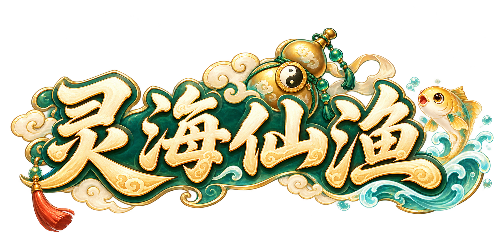

# 灵海仙渔 · 道家Q版捕鱼首发美术

**本批首发美术完成，已在本机 Unity 6000.6.0f1 完成实际导入、编译和逐项验收。** 交付 31 项UI设计、276项静态/FX资源、81套648张原生动作帧，共924项运行PNG；另有146页图集。最终范围与输入哈希见 [最终验收](docs/UNITY_FINAL_ACCEPTANCE.json)。

## 直接查看

- [Unity工程与运行步骤](unity/BuyuClient/README.md)，打开 Assets/Scenes/BuyuArtReview.unity，点击Play。
- [独立素材与动作审阅台](assets-preview/index.html)，无需服务器；支持筛选、逐帧、明暗叠底和炮台旋转。
- [31项UI完整图集](gallery/index.html)、[界面资源映射](docs/UI_RUNTIME_ART_MAP.md)。
- [交付说明](docs/GAME_ART_DELIVERY.md)、[实际状态](docs/GAME_ART_STATUS.json)、[逐项画面与报告](docs/acceptance/README.md)。

## 交付内容

36鱼种静态精灵及游动/捕获，3个Boss额外攻击/怒态，道童待机/指向/庆祝；6套炮台12部件；4海域与1港口；6头像与道童全身；34个UI组件、36图标、6技能、9饰件、2活动插画、正式Logo；8组共128帧FX。81套角色动作各8帧，共40循环、41单次；含FX共89个clip。

所有PNG保持实际原生像素，注册仅用整数平移和透明补边；每个clip统一显示比例，不按逐帧包围框缩放。正式名称为《灵海仙渔》，Logo原生1774×887。品牌、炮口、UI状态、技能及字体配置在config目录。两款Noto CJK字体附OFL。

美术完成范围对应本批首发合同。31张整屏是布局与视觉设计；动态文字、数据、交互窗口及游戏业务仍由客户端实现。随包Unity工程提供实际可运行的美术审阅和离线捕鱼演示，验收未覆盖联网服务、经济系统、声音音乐、商店宣传素材或Standalone构建。

## 上传与接手

公开仓库：[lhl-java/luhailong-python](https://github.com/lhl-java/luhailong-python)，项目位于buyu-image。当前冻结包通过 [PUBLIC_RELEASE_MANIFEST.json](../PUBLIC_RELEASE_MANIFEST.json) 核对每个文件；实际远端提交及下载验收以本地docs/PUBLIC_UPLOAD_RECEIPT_CURRENT.json为准，该回执在Push后产生，不递归收入本次提交。旧225项批次回执继续作为历史证据。

新电脑保留整个buyu-image结构，先读 [长期指令](AGENTS.md)、[美术定调](docs/ART_DIRECTION.md)和[模型记录政策](docs/IMAGE_MODEL_POLICY.md)，确认邮件/组队两主参考实际存在。实际图像工具未披露的型号/质量保持未确认，不把配置目标写成已锁定结果。

后续参考素材放 [references/incoming](references/incoming/) 下对应ui/characters/fish/cannons/requirements目录。制作工具会在验收输入完全未变时复用已通过状态；修改PNG、时序、根点、尺寸或接入代码后必须复验受影响项。
