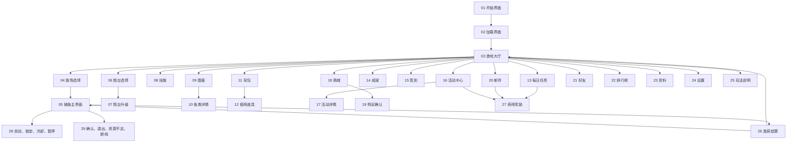

# 捕鱼 UI 导航与状态

本图对应 [31 项清单](UI_SUITE_20261026.json)，用于 UI 美术与后续客户端接入对照。页面中数据为演示值，功能规则由客户端任务再确定。

30 空白／加载／获取失败状态适用于邮件、好友及需要异步数据的窗口；31 通用控件图统一按钮主次、禁用／选中、页签、开关、复选、进度和物品格的画法。

## 状态语义

| 情况 | 视觉与操作 |
|---|---|
| 可领取 | 明确的玉绿主按钮与奖励图标 |
| 未完成 | 进度小于目标，入口“去完成”，不同时显示“已领取” |
| 已领取 | 完成进度与低强调已领取状态，无重复领取主操作 |
| 未解锁 | 锁图标、降低强调，和空槽／禁用分别呈现 |
| 选中 | 玉绿底或细金高亮，区别于鼠标悬停与禁用 |
| 等待数据 | 加载标记，避免残留上一次可操作内容 |
| 无数据 | 明确空态，有需要时给出添加／返回入口 |
| 获取失败 | 简短说明与重试入口 |
| 网络中断 | 重连状态及返回大厅入口 |
| 确认操作 | 明确对象、数量和主次按钮，取消可回到原窗口 |

整屏图片和状态图展示视觉设计。真实文字、列表、输入、弹窗焦点、滚动和服务器回执需要后续按客户端接口分别实现。
