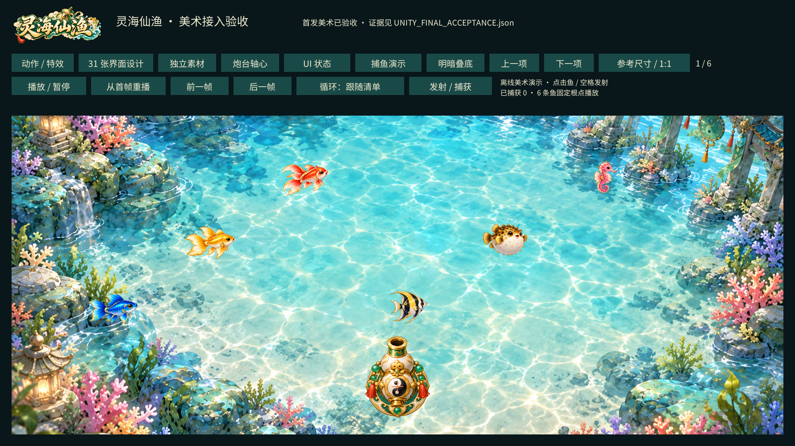
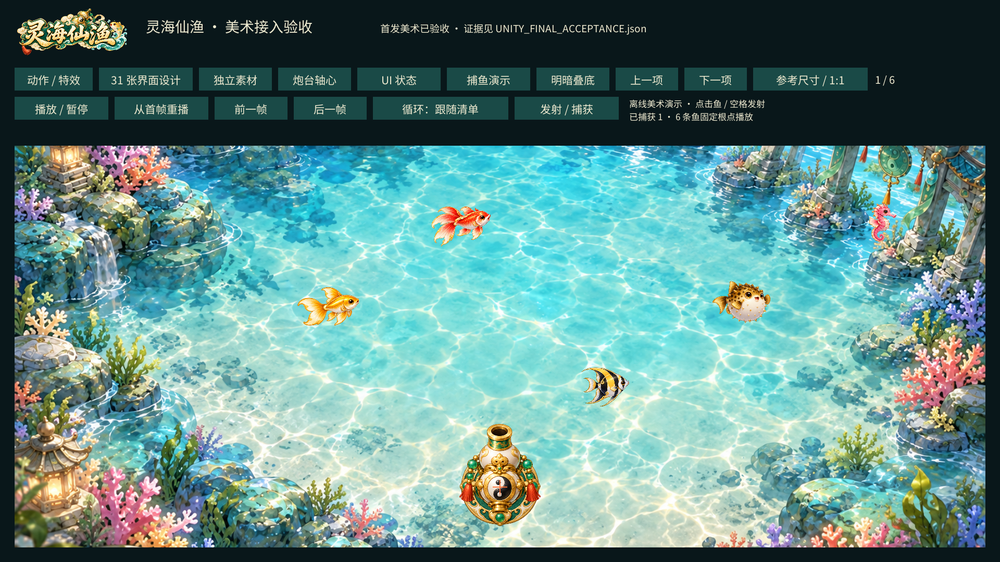

# 首发美术验收证据

最终状态和输入SHA256在[UNITY_FINAL_ACCEPTANCE.json](../UNITY_FINAL_ACCEPTANCE.json)。[AGENT_VISUAL_REVIEW.json](AGENT_VISUAL_REVIEW.json)记录root agent实际查看范围、修正和限制，没有声称人类手动验收。

- unity-import.json：实际Unity导入/编译后的1087项技术检查，955贴图、924Sprite、89clip、31设计图、8类22状态与2字体。
- runtime-all-89.json：实际PlayMode覆盖全部89clip所有帧，检查loop回绕/单次完成与回调。
- runtime-fx-boss-supplement.json：完整16帧FX联系图和固定整只Boss视窗。
- runtime-ui-cannon-final.json：最终按钮状态、18个炮口角度、9次九宫格拉伸、实际指针与捕获事件。
- motion/：89张实际Unity逐帧渲染联系图，FX为16格；同clip固定视窗、根点和源显示比例。
- screens/：31项实际Unity设计图显示；ui/：8类状态；cannons/：6炮台与多角度；stretch/：3组件各3宽度。

以上图片为确定性Unity画面导出，不是新增AI生图。报告自己的manualVisualApproval/gameArtComplete=false保留原始技术范围，最终视觉审阅与完成结论单独在上层封存，未篡改历史报告。原生像素、来源、时长和显示比例证据仍在assets清单和逐图记录中。
